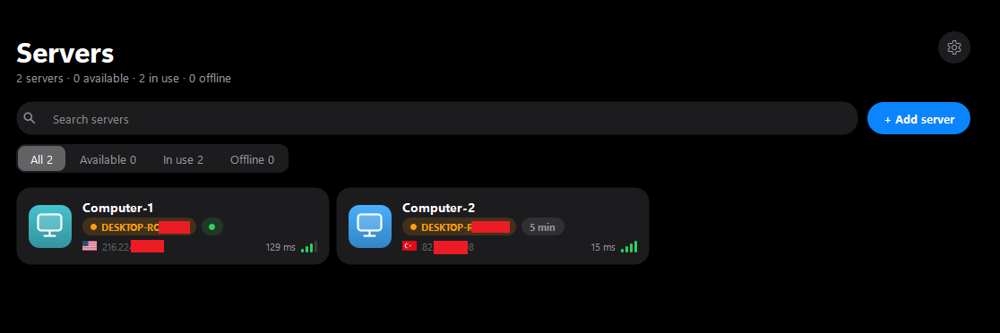

<p align="center"></p>

# RConnect

RConnect saves your Remote Desktop servers and connects to them in one click. Each connection
opens in a tab, and tabs can be dragged to another window or monitor. It uses the Remote Desktop
client built into Windows (`mstscax.dll`).

<p align="center"></p>

Each server card shows the country of the server's IP address, looked up offline in an embedded
copy of the DB-IP Lite database (`python tools/update_geodata.py` refreshes it).

Each card also shows the connection quality: the time to open the RDP port (average of the last
checks) as signal bars (under 60 ms excellent, 130 good, 250 fair, slower poor). The list can be
filtered (All, Available, In use, Offline), searched, and is sorted by name; it stays responsive
with a hundred servers because checks run at most eight at a time.

If the server's WinRM port (5985) is open, the card also shows who is connected (computer name and
idle time), and RConnect warns before you connect to a server someone else is using. It runs
`quser` over WinRM with the saved user name and password, which must be an administrator on the
server. Turn it off per server under Advanced settings.

Windows 10 (1809) or later, 64-bit. English and Turkish UI.

## Shortcuts

| Keys | Action |
| --- | --- |
| `F11` | Full screen on / off |
| `Ctrl+Tab`, `Ctrl+Shift+Tab` | Next / previous tab |
| `Alt+1` … `Alt+9` | Go to tab |
| `Ctrl+W` | Close tab |
| `Ctrl+N` | Add server |
| `Ctrl+B` | Show / hide the tab bar |
| `F5` | Check server status |

## Data

The server list is stored in `%LOCALAPPDATA%\RConnect\RConnect\servers.json`. Passwords and
notes are encrypted with Windows DPAPI, so only the same Windows user on the same PC can read
them.

Closing a tab disconnects the session. To have the server log off disconnected sessions, set
`MaxDisconnectionTime` on the server:

```bat
reg add "HKLM\SOFTWARE\Policies\Microsoft\Windows NT\Terminal Services" /v MaxDisconnectionTime /t REG_DWORD /d 60000 /f
gpupdate /force
```

## Building

Needs Visual Studio 2022 or later (C++), CMake 3.21+ and Qt 6 for `msvc2022_64` with Active Qt.

```bat
cmake --preset msvc
cmake --build build
```

`build-release.bat` builds `dist\RConnect\` and `dist\RConnect-<version>-win64.zip` with only
the files the app needs. Set `QT_DIR` if Qt is not in `C:\Qt\6.11.1\msvc2022_64`.

Set `RCONNECT_TEST=1` to run with a separate, empty configuration.

Translations are in `i18n/`. After changing UI strings, run
`cmake --build build --target update_translations` and translate the new entries.

## License

[MIT](LICENSE). Third-party components: [THIRD-PARTY-NOTICES.txt](THIRD-PARTY-NOTICES.txt).

<a href="https://db-ip.com">IP Geolocation by DB-IP</a>
