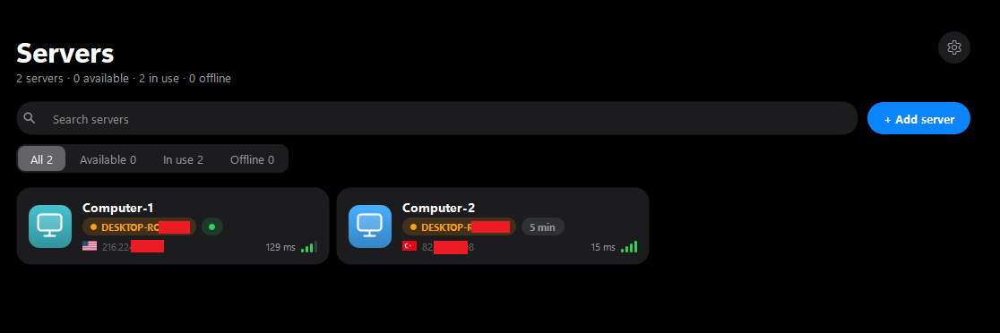

<p align="center"></p>

# RConnect

RConnect saves your Remote Desktop servers and connects to them in one click. Each connection
opens in a tab, and tabs can be dragged to another window or monitor. It uses the Remote Desktop
client built into Windows (`mstscax.dll`).

<p align="center"></p>

Each server card shows the country of the server's IP address, looked up offline in an embedded
copy of the DB-IP Lite database (`python tools/update_geodata.py` refreshes it).

Each card also shows the connection quality: the time to open the RDP port (average of the last
checks) as signal bars (under 60 ms excellent, 130 good, 250 fair, slower poor). The list can be
filtered (All, Available, In use, Offline), searched, and is sorted by name; it stays responsive
with a hundred servers because checks run at most eight at a time.

If the server's WinRM port (5985) is open, the card also shows who is connected (computer name and
idle time), and RConnect warns before you connect to a server someone else is using. It runs
`quser` over WinRM with the saved user name and password, which must be an administrator on the
server. Turn it off per server under Advanced settings.

## Access log

Recording server events is off by default; turn it on under Settings > Logging > Record server access
events. Adding a server and connecting to one are always recorded. Detailed logging (same menu) adds
the other actions taken in RConnect.

With the same WinRM check, RConnect records what happens on each server, including people who did
not use RConnect, and appends it to `%LOCALAPPDATA%\RConnect\RConnect\access-log.csv` once a minute.
The file only grows. The first check of a server reads the last 7 days; after that only newer
events are read, so nothing is missed while RConnect is closed or minimized, as long as the server
still has them.

| Log on the server | Events |
| --- | --- |
| TerminalServices-LocalSessionManager | 21 logon, 23 logoff, 24 disconnect, 25 reconnect (user, client address, session) |
| TerminalServices-RemoteConnectionManager | 1149 user authenticated (client address) |
| Security | 4624 RDP logon, 4625 failed logon (reason), 4778 reconnect, 4779 disconnect (client name and address) |

The Security events need the server to audit logons. Right-click a server → *Turn on logon
auditing…* sets the audit policy for *Logon* and *Other Logon/Logoff Events* over WinRM, after asking.

Lines with source `RCONNECT` record what was done through RConnect: *Connect*, *Monitor* and
*AuditEnable*, with the Windows user who ran RConnect (`operator`), since the server only sees the
saved administrator account.

The **Access log** page filters the file and exports what is shown to CSV.

## Time on servers

The **Time on servers** page shows, per day, server and computer (client name and IP address), how
many visits there were, the first and last time, the total time, the active time and the away
(AFK) time; open a row for every visit with its start and end, and under it each away or unknown
stretch.

- **Entering and leaving** come from the server's session events (21, 23, 24, 25 above), which are
  exact. They are copied into `usage-events.csv` (UTC); **Recalculate from log** rebuilds that file
  from `access-log.csv`, so past days can always be recalculated.
- **Away (AFK)** comes from the idle time `quser` reports at each check (about every 2 minutes), saved
  with the server's own clock in `usage-samples.csv`. Idle for 5 minutes or more counts the whole idle
  stretch as away. Before this file existed there is no idle history, so older time is shown as
  *unknown* (it is never guessed): presence is exact, the active/away split is not known.
- **One visit**: a reconnect within 5 minutes from the same IP address (and the same computer name,
  if known) is the same visit; the break is not counted.
- **Unknown**: the stretch of a visit where nobody measured (RConnect closed, server unreachable).
  A connected person that `quser` shows but the event log does not have, and the other way round, is
  flagged on the page, and the visit is marked as "not in the log" or "no sign-out in the log".
- Times are stored in UTC and shown in this PC's time zone; a day ends at this PC's midnight.
- **Error margin**: entering and leaving are exact to the second; idle time has whole-minute precision
  and checks are about 2 minutes apart, so each away stretch can be off by up to about 2 minutes
  (it is rather too short than too long). The rules are in `src/core/UsageEngine.h`.

`RConnect.exe --usage-diag <file>` asks every server (read only) for its clock, `quser`, `qwinsta`,
the newest session events and the state of the session log, and writes it to `<file>`, to check the
log against the server by hand.

Besides sign-ins, the same check reads changes that point to tampering. They need no audit policy
unless noted, and *Turn on logon auditing…* also turns on what they need:

| Log on the server | Events |
| --- | --- |
| Security | 4720 user account created, 4732 member added to Administrators or Remote Desktop Users, 4698 scheduled task created (these three need auditing), 1102 audit log cleared |
| System | 7045 service installed, 104 log cleared |

## Security alerts

RConnect looks at new events and writes an `Alert…` line (red, category *Security alerts*) and shows a
Windows notification. Only events from the last 24 hours alert; older ones are history.

| Alert | When |
| --- | --- |
| Password guessing | 5 failed sign-ins from one address within 10 minutes (again after 30 minutes) |
| Sign-in after failed attempts | an account signs in from an address that failed at least 3 times in the last hour |
| New country | an account signs in from a country it was not seen in on that server before (the first sign-in a server is seen with only sets the baseline; addresses are looked up offline) |
| Suspicious new program | a new service or scheduled task that runs PowerShell, `cmd /c`, `mshta`, `rundll32`, a script host, a download, or a program from a temp, AppData or Public folder |
| Tampering | a new user account, a new administrator or Remote Desktop user, or a cleared event log (always) |

## Live sessions

**Live sessions** lists everyone who is logged on to the servers.

- *Watch screen* opens a window with a screenshot of the user's session, refreshed every few
  seconds, view only. It works over WinRM, so it also works across the internet. A WinRM shell
  cannot see the user's screen, so RConnect creates a one-off scheduled task that runs interactively
  as that user, takes the picture in their session, and reads it back; the task and its files are
  deleted afterwards. The session has to be active and unlocked. A console window may flash briefly
  on the user's screen at each capture.
- *Shadow (LAN)* starts `mstsc /shadow:<id>` without `/control`. It uses RPC (ports 135 and up),
  not the RDP port, so it only works inside a network, not across the internet. Whether the user is
  asked first is the server's own policy (Group Policy: *Set rules for remote control of Remote
  Desktop Services user sessions*); RConnect does not bypass it.

- *Send message…* shows a message (up to 255 characters) in a window on the user's screen, using
  `msg.exe` on the server. It is written to the access log.

Every watch is written to the access log. Employees should be told that their sessions can be
watched.

Windows 10 (1809) or later, 64-bit. English and Turkish UI.

## Shortcuts

| Keys | Action |
| --- | --- |
| `F11` | Full screen on / off |
| `Ctrl+Tab`, `Ctrl+Shift+Tab` | Next / previous tab |
| `Alt+1` … `Alt+9` | Go to tab |
| `Ctrl+W` | Close tab |
| `Ctrl+N` | Add server |
| `Ctrl+B` | Show / hide the tab bar |
| `F5` | Check server status |

## Data

The server list is stored in `%LOCALAPPDATA%\RConnect\RConnect\servers.json`. Passwords and
notes are encrypted with Windows DPAPI, so only the same Windows user on the same PC can read
them.

Closing a tab disconnects the session. To have the server log off disconnected sessions, set
`MaxDisconnectionTime` on the server:

```bat
reg add "HKLM\SOFTWARE\Policies\Microsoft\Windows NT\Terminal Services" /v MaxDisconnectionTime /t REG_DWORD /d 60000 /f
gpupdate /force
```

## Building

Needs Visual Studio 2022 or later (C++), CMake 3.21+ and Qt 6 for `msvc2022_64` with Active Qt.

```bat
cmake --preset msvc
cmake --build build
```

`build-release.bat` builds `dist\RConnect\`, `dist\RConnect-<version>-win64.zip` and the installer
`dist\RConnect-<version>-setup.exe` with only the files the app needs. `RConnect.exe` and the
installer are signed with the code-signing certificate named "Lurid Lane" (the publisher) from the
current user's certificate store. Needs Inno Setup 6 and the Windows SDK (`signtool`).
Every run raises the patch number in the `VERSION` file (1.1.0 -> 1.1.1); edit the file by hand for a
new major or minor version. Environment variables: `KEEP_VERSION=1` (rebuild without raising it), `QT_DIR` (if Qt is not in `C:\Qt\6.11.1\msvc2022_64`), `SIGN_CN` (another
certificate name), `SKIP_SIGN=1` (build unsigned).

### Releases and updates

Pushing a changed `VERSION` file to `main` runs `.github/workflows/release.yml`: it builds the zip
and the installer on GitHub, and publishes release `v<version>` (skipped if that release exists).
The run can also be started by hand from the Actions tab. To sign the files in CI, add the
repository secrets `SIGN_PFX_BASE64` (the `.pfx`, base64 encoded) and `SIGN_PFX_PASSWORD`;
without them the build is unsigned.

RConnect looks for a newer release about 20 seconds after it starts and then every 12 hours
(Settings > Check for updates automatically). Settings > Check for updates... checks right away.
If RConnect was installed with the installer, "Update now" downloads the new installer, verifies
its SHA-256 and runs it; a portable copy opens the release page instead.

Settings > Start with Windows opens RConnect minimized at sign-in and keeps watching the servers;
the installer offers the same as an option.

Set `RCONNECT_TEST=1` to run with a separate, empty configuration.

Translations are in `i18n/`. After changing UI strings, run
`cmake --build build --target update_translations` and translate the new entries.

## License

[MIT](LICENSE). Third-party components: [THIRD-PARTY-NOTICES.txt](THIRD-PARTY-NOTICES.txt).

<a href="https://db-ip.com">IP Geolocation by DB-IP</a>
